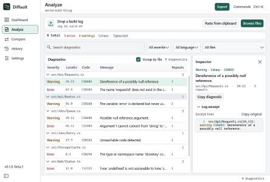
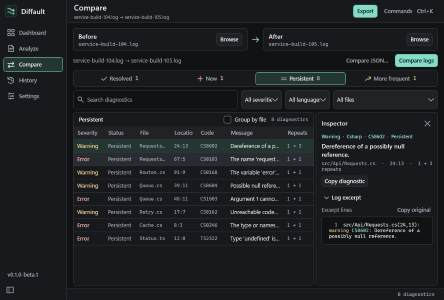

# Diffault

Diffault is a native Windows workspace for compiler and runtime diagnostics. Open a build log to inspect grouped findings, or compare builds to see what appeared, was resolved, persisted, or occurred more often. Analysis, filtering and SQLite history run locally.

**[Download the Windows x64 beta](https://github.com/zaanw/Diffault/releases)** · **[Installation and checksums](INSTALL.md)** · **[Changelog](CHANGELOG.md)**

## Windows desktop

| Analyze · light | Compare · dark |
| --- | --- |
|  |  |

Screenshots captured from the Windows beta using sample build logs.

The Windows x64 build contains the WPF application, Rust engine, .NET runtime and SQLite. Download the versioned portable ZIP from [GitHub Releases](https://github.com/zaanw/Diffault/releases), choose **Extract All**, then run `Diffault.exe` inside the extracted `Diffault` folder. Keep its companion files together. The package works offline on supported Windows x64 systems with normal user permissions.

- **Dashboard** shows the configured project, latest analysis, build delta, and recent reports. Open a log, paste text, or try the built-in sample logs directly from this page.
- In **Compare**, select or drop logs in **Before** and **After**, then click **Compare logs**. Select **Resolved**, **New**, **Persistent**, **More frequent**, or **Less frequent** to inspect each group. Use the button between the input panes to swap two selected files.
- In **Analyze**, open a log, drop it, or choose **Paste from clipboard**. Filter by severity, language, file or repeated diagnostics, and group the table by source file. Select a row to open the resizable inspector with syntax-highlighted, numbered excerpt lines. **Copy original** copies the complete diagnostic text even when the preview is limited.
- **History** supports column sorting, search, filtering by type, and opening saved reports. Ctrl-select two to eight saved standalone analyses and click **Compare selected** to inspect consecutive pairs in chronological order. Existing history stays in `%LOCALAPPDATA%\ErrorHunt\history.db`. Choose a local project folder and an editor in **Settings** to enable **Open source**.

Press **Ctrl+K** to search commands and pages, **Ctrl+O** to open a log, **Ctrl+F** to focus the current search, or **Ctrl+1** through **Ctrl+5** to switch pages. The diagnostic table also supports **Ctrl+C** to copy the selected diagnostic. The toolbar exports the current report to Markdown, JSON or SARIF. A timeline export contains the currently selected pair.

In **Settings → Appearance**, choose **System**, **Light**, or **Dark**, then save. **System** follows the Windows app appearance setting. **Settings → Diagnostics** opens or exports local startup and error codes. The log at `%LOCALAPPDATA%\ErrorHunt\diagnostics.log` omits filenames, raw messages, stack traces, and log contents. If the .NET host cannot load at all, there may be no new log entry. Extract the complete archive again and keep all of its files in the same folder.

Use **About Diffault** from the sidebar version button or the command palette to see what's new, request an update check, or open the issue form. Update checks query GitHub Releases without sending logs or settings. Recognized VS Code, VSCodium, Notepad++, Sublime Text and JetBrains executables receive the captured line and column when their command lines support it.

The engine supports common formats for C, C++, C#, Go, Java, Lua, PHP, Python, Rust, SQL, Swift and TypeScript. Log files can be UTF-8 (with or without BOM) or BOM-marked UTF-16. Invalid byte sequences are replaced. Obvious binary files are rejected. Colored compiler output and MSVC line diagnostics are supported. The engine accepts files up to 64 MiB per log and displays positions only when captured from the log.

Duplicates are grouped by language, severity, normalized path, code and message whitespace. The report shows a count and retains the first displayed source location for each group. **Existing** also shows the count from the earlier log. Select **More frequent** to find issues that appeared more times in the second build. The offline viewer offers the same filter and displays counts as `before → after`. Comparisons ignore changes to line and column. A file rename or wording change can appear as **Fixed** plus **New** because the engine cannot establish that they refer to the same diagnostic. Standalone scans use the **New** group so scans and comparisons share an export format.

## Try a sample build

In **Dashboard → Sample logs**, choose **Analyze test log**, **Compare samples**, or **Save log…**. Built-in sample runs leave your history and dashboard statistics unchanged. You can also download [sample-after.log](examples/sample-after.log) and [sample-before.log](examples/sample-before.log) and open them normally.

## Build the Windows x64 app

Use the .NET 10 SDK, Rust 1.100.0 and the Visual Studio Build Tools C++ toolchain with a Windows SDK. Run from the repository root in PowerShell.

```powershell
rustup toolchain install 1.100.0 --profile minimal
cargo +1.100.0 test --locked --manifest-path engine/Cargo.toml
cargo +1.100.0 build --release --locked --manifest-path engine/Cargo.toml --target x86_64-pc-windows-msvc
$engine = (Resolve-Path engine/target/x86_64-pc-windows-msvc/release/errorhunt-engine.exe).Path
dotnet run --project checks/ErrorHunt.Checks.csproj -p:RestoreLockedMode=true -- $engine
dotnet publish desktop/ErrorHunt.Desktop.csproj -c Release -r win-x64 --self-contained -p:RestoreLockedMode=true "-p:EngineExecutable=$engine" -o artifacts/win-x64
.\artifacts\win-x64\Diffault.exe
```

The Diffault Desktop workflow builds a self-contained ZIP, compares every extracted file with the staged package, launches the extracted executable from a separate working directory, and runs WPF workflow and screenshot tests using a separate test build. The portable ZIP excludes the test harness and debug symbols. The integration check runs the supplied engine against Unicode logs, verifies the three categories, checks JSON and SARIF output and reopens the saved report from SQLite.

## Python compatibility CLI

Requires Python 3.10 or newer.

```sh
python -m pip install -e . pytest
python -m pytest -q
diffault scan build.log --json
diffault compare before.log after.log --json
```

The `errorhunt` command is also available for existing scripts.

## Batch processing and offline viewer

The Go CLI scans several logs concurrently and emits one JSON array in argument order. Each entry contains a file and its diagnostics or its error. The exit status is nonzero if any scan fails. With Go 1.25 or later, run from the repository root after building the Rust engine for your platform.

```sh
cd batch
go run . -engine ../engine/target/debug/errorhunt-engine -jobs 4 first.log second.log
ERRORHUNT_TEST_ENGINE="$(cd ../engine/target/debug && pwd)/errorhunt-engine" go test -v ./...
```

For the browser viewer, run `npm ci` and `npm test` from `viewer/`. Open the generated standalone `viewer/dist/index.html` in a browser and choose an exported comparison JSON file. The viewer filters and paginates locally using that file. It also accepts the JSON output of `errorhunt-engine compare BEFORE AFTER`.

## Component protocol

WPF and the Go CLI pass arguments to the Rust engine without a shell. The engine writes UTF-8 JSON to stdout and returns a nonzero exit code on input errors.

| Command | Output |
| --- | --- |
| `scan FILE` | Diagnostic array |
| `compare BEFORE AFTER` | Object with `fixed`, `new`, and `existing` diagnostic arrays |
| `compare-reports BEFORE_JSON AFTER_JSON` | The same comparison object, using diagnostic arrays produced by adapters or previous scans |
| `stdin` | Accepts a JSON object with `before` log text and optional `after` log text. Returns the same shape as scan or compare. |
| `compare-stdin` | Accepts a JSON object with `before` and `after` diagnostic arrays and returns the standard comparison object. |

Each diagnostic contains `language`, `severity`, `file`, `line`, `column`, `code`, `message`, `original` and `count`. Existing diagnostics from a comparison also include `previous_count` in JSON and in the SARIF result properties. Older reports may omit the earlier count. Unavailable location fields and codes are null. The Rust engine calls the C encoding detector and the C++ Windows path classifier through a narrow C ABI. The WPF reporting library uses `reports/history.sql` to initialize its SQLite database.

## Optional adapters and filtering

The desktop app handles common formats directly. For additional Maven and JVM stack trace formats, PHP runtime logs or Swift driver diagnostics, run the corresponding adapter explicitly with a UTF-8 log on stdin. The WPF **Compare diagnostic JSON** action accepts the resulting arrays. The engine command `compare-reports` does the same on the command line.

| Tool | Example |
| --- | --- |
| Java 21 | `java adapters/JvmDiagnostics.java < build.log > diagnostics.json` |
| PHP 8.2+ | `php -n adapters/php_diagnostics.php < php.log > diagnostics.json` |
| Swift 6 | `swift adapters/swift_diagnostics.swift < swift.log > diagnostics.json` |
| Lua 5.4 with lua-cjson | `lua5.4 adapters/filter.lua local-rules.tsv < diagnostics.json > filtered.json` |

The Lua filter removes a diagnostic if any rule's case-sensitive literal matches the specified field. Put one field and literal per line, separated by a tab. Supported fields are language, severity, file, code and message. Lines starting with `#` are comments. The rules file contains data and is never executed as Lua.

Run `python3 adapters/check.py engine/target/debug/errorhunt-engine java` to test Java against the local engine. Substitute `php`, `swift` or `lua` to test each adapter with the corresponding runtime installed.

See [CONTRIBUTING.md](CONTRIBUTING.md), [SECURITY.md](SECURITY.md) and the [MIT license](LICENSE).
